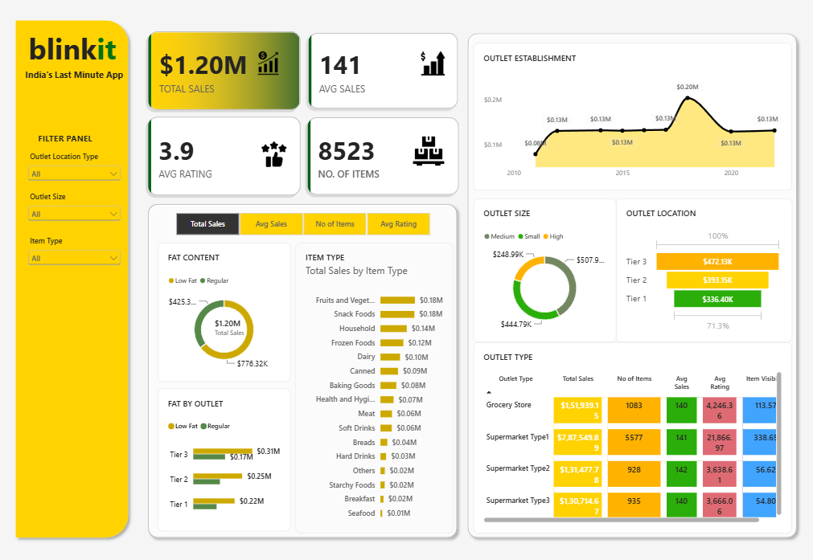

# Blinkit Sales Analysis Dashboard 📊

## 📌 Project Overview

This project presents an interactive **sales analysis dashboard for
Blinkit**, an Indian last-minute delivery app. The dashboard was
developed using **Microsoft Power BI** to analyze sales performance
across products, outlet types, outlet sizes, and outlet locations.

The objective of the project is to transform raw sales data into
meaningful business insights through interactive KPIs, charts, filters,
and comparative analysis.

> **Note:** This is a self-initiated Power BI analytics project created
> to demonstrate data analysis, visualization, and business intelligence
> skills.

------------------------------------------------------------------------

## 🎯 Business Objectives

The dashboard was designed to answer key business questions such as:

-   What are the overall sales and average sales performance?
-   Which product categories generate the highest sales?
-   How do sales differ between Low Fat and Regular Fat products?
-   Which outlet sizes contribute the most to total sales?
-   Which outlet locations perform better?
-   How do different outlet types compare in terms of sales, item count,
    rating, and item visibility?
-   How has sales performance changed based on outlet establishment
    year?
-   Which areas or outlet segments could represent potential growth
    opportunities?

------------------------------------------------------------------------

## 🛠️ Tools & Technologies

-   **Microsoft Power BI**
-   **Power Query** -- Data cleaning and transformation
-   **DAX** -- Measures and KPI calculations
-   **Data Visualization** -- Interactive charts and dashboards
-   **CSV Dataset** -- Source data

------------------------------------------------------------------------

## 📊 Dashboard KPIs

  KPI                           Value
  --------------------- -------------
  **Total Sales**         **\$1.20M**
  **Average Sales**         **\$141**
  **Average Rating**          **3.9**
  **Number of Items**       **8,523**

------------------------------------------------------------------------

## 📈 Dashboard Visualizations

### 1. Outlet Establishment Trend

A line chart tracks sales performance across outlet establishment years.

The dashboard shows a notable increase around **2018**, representing an
important growth period, followed by changes in sales across subsequent
years.

### 2. Sales by Fat Content

The dashboard compares sales between Low Fat and Regular Fat products:

-   **Regular Fat:** \$776.32K
-   **Low Fat:** \$425.36K

Regular Fat products contribute a larger share of total sales in the
dataset.

### 3. Sales by Item Type

The item-type analysis identifies the categories contributing most to
sales.

Top-performing categories include:

-   **Fruits and Vegetables:** approximately \$0.18M
-   **Snack Foods:** approximately \$0.18M
-   **Household:** approximately \$0.14M
-   **Frozen Foods:** approximately \$0.12M
-   **Dairy:** approximately \$0.10M

This helps identify product categories with stronger revenue
contribution.

### 4. Sales by Outlet Size

The dashboard compares sales across different outlet sizes.

**Medium-sized outlets** generate the highest sales contribution at
approximately **\$507.90K**, followed by the other outlet-size segments.

### 5. Sales by Outlet Location

Sales are analyzed across Tier 1, Tier 2, and Tier 3 locations.

-   **Tier 3:** \$472.13K
-   **Tier 2:** \$393.15K
-   **Tier 1:** \$336.40K

The analysis indicates that Tier 3 locations contribute the highest
sales among the three location categories.

### 6. Outlet Type Analysis

The dashboard provides a detailed comparison of outlet types using:

-   Total Sales
-   Number of Items
-   Average Sales
-   Average Rating
-   Item Visibility

This allows different outlet formats to be compared from multiple
performance perspectives.

------------------------------------------------------------------------

## 🎛️ Interactive Filters

The dashboard includes an interactive filter panel that allows users to
dynamically analyze the data based on:

-   **Outlet Location Type**
-   **Outlet Size**
-   **Item Type**

Users can combine these filters to drill down into specific segments and
understand their performance.

------------------------------------------------------------------------

## 💡 Key Business Insights

Based on the dashboard analysis:

1.  **Regular Fat products contribute more sales** than Low Fat products
    in the analyzed dataset.
2.  **Fruits and Vegetables and Snack Foods** are among the
    strongest-performing item categories.
3.  **Medium-sized outlets** have the highest sales contribution among
    outlet-size categories.
4.  **Tier 3 locations** generate the highest sales compared with Tier 1
    and Tier 2 locations.
5.  The outlet-type comparison highlights differences in sales, item
    volume, ratings, and item visibility.
6.  The establishment-year analysis shows a significant sales peak
    around **2018**, indicating an important growth period.

------------------------------------------------------------------------

## 📷 Dashboard Preview



> Place the dashboard screenshot in the project folder and name it
> `dashboard.png` for the preview above to display correctly on GitHub.

------------------------------------------------------------------------

## 📂 Suggested Repository Structure

``` text
Blinkit-Sales-Analysis/
│
├── Blinkit Dashboard.pbix
├── dashboard.png
├── dataset/
│   └── blinkit_data.csv
└── README.md
```

------------------------------------------------------------------------

## 🚀 Project Highlights

-   Built an end-to-end **Power BI sales analytics dashboard**
-   Created KPI cards for important business metrics
-   Used multiple visualizations to analyze sales from different
    dimensions
-   Added interactive slicers for dynamic analysis
-   Compared outlet performance by size, location, and type
-   Analyzed product-level sales and consumer-related attributes
-   Converted raw data into an interactive business intelligence report

------------------------------------------------------------------------

## 👩‍💻 Author

**Nidhi Chaukiyal**

B.Tech -- Information Technology\
Indira Gandhi Delhi Technical University for Women (IGDTUW)

------------------------------------------------------------------------

## ⭐ Conclusion

The Blinkit Sales Analysis Dashboard provides a consolidated view of
sales performance across products and outlets. By combining KPIs,
product analysis, outlet segmentation, location analysis, and
interactive filtering, the dashboard helps identify high-performing
segments and potential areas for business growth.

This project demonstrates practical skills in **data cleaning, data
analysis, DAX, Power BI visualization, dashboard design, and
business-oriented insight generation**.
